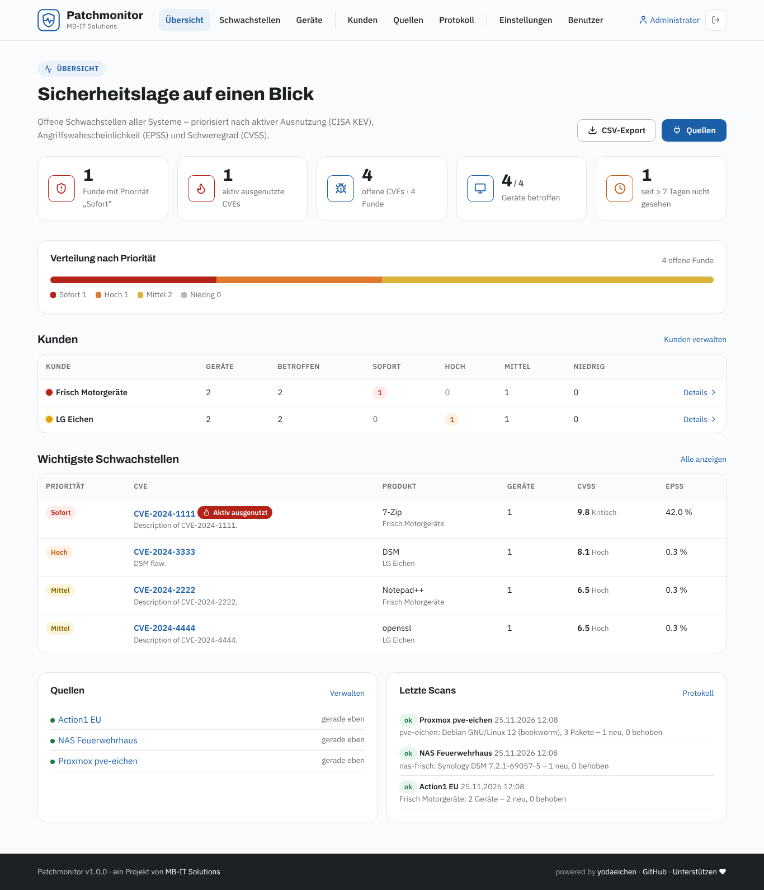

# Patchmonitor

**Schwachstellen-Dashboard für kleine IT-Umgebungen.** Patchmonitor sammelt installierte Software und bekannte Sicherheitslücken aus **Action1**, von **Synology- und QNAP-NAS** sowie von **Linux-Servern und Proxmox**. Es reichert die Funde mit **CISA KEV**, **FIRST EPSS** und der **NVD** an und zeigt pro Kunde verständlich, was zuerst zu tun ist und wie.

Ein Open-Source-Projekt von [MB-IT Solutions](https://www.mbit.solutions) · powered by [yodaeichen](https://github.com/yodaeichen)



## Funktionen

- **Action1 als Datenquelle:** Endpoints, CVEs mit betroffener Software und verfügbaren Updates sowie optional das Software-Inventar über die offizielle REST-API 3.0. Action1-Organisationen werden automatisch zu Kunden.
- **Synology & QNAP per SSH:** Firmware (DSM, QTS, QuTS hero) und installierte Pakete. Der Abgleich läuft per CPE gegen die NVD und liefert die Version, ab der die Lücke behoben ist.
- **Linux / Proxmox per SSH:** Die Paketliste (Debian, Ubuntu, AlmaLinux, Rocky, Alpine) wird gegen OSV.dev geprüft. Als Fund zählt nur, wofür es ein Update gibt.
- **Priorisierung:** Die Stufen sind *Sofort*, *Hoch*, *Mittel* und *Niedrig*. „Sofort“ gilt für aktiv ausgenutzte Lücken (CISA KEV) oder kritische Lücken mit hoher Angriffswahrscheinlichkeit (EPSS).
- **Abhilfe auf Deutsch:** Je nach Gerätetyp gibt es konkrete Schritte, z. B. Update über Action1, DSM aktualisieren oder `apt full-upgrade`. Dazu kommen Links zu NVD, CISA und Hersteller.
- **Kunden & Rechte:** Es gibt drei Rollen: Administrator, Techniker und Leser. Leser-Zugänge sind auf einzelne Kunden beschränkbar, z. B. für Kunden selbst.
- **Benachrichtigung** per E-Mail (SMTP, z. B. mailcow) oder Webhook (z. B. DIVERA Gateway, Teams, n8n). Gemeldet werden neue Funde mit hoher Priorität.
- **CSV-Export,** Risiko akzeptieren mit Begründung, Scan-Protokoll.
- **Sicherheit:**
  - Zugangsdaten werden verschlüsselt gespeichert (Fernet).
  - SSH-Host-Schlüssel werden geprüft (TOFU).
  - CSRF-Schutz, Login-Sperre, CSP und `Secure`-Cookies hinter HTTPS.
  - Keine externen Schriften oder CDNs.

## Installation auf Proxmox (Einzeiler)

Auf dem Proxmox-Host als root:

```bash
bash -c "$(curl -fsSL https://raw.githubusercontent.com/yodaeichen/patchmonitor/main/proxmox/install.sh)"
```

Das Skript erledigt Folgendes:

- Es legt einen unprivilegierten Debian-LXC an: 2 Kerne, 1 GB RAM, 8 GB.
- Es installiert Patchmonitor als systemd-Dienst auf Port 8000.
- Am Ende zeigt es den ersten Zugang an.
- Auf Wunsch legt es gleich den Proxy-Host im **Nginx Proxy Manager** an.

Mit fester IP:

```bash
IP=172.15.15.60/24 GW=172.15.15.1 bash -c "$(curl -fsSL https://raw.githubusercontent.com/yodaeichen/patchmonitor/main/proxmox/install.sh)"
```

| Variable | Standard | Bedeutung |
|---|---|---|
| `CTID` | nächste freie | Container-ID |
| `CT_HOSTNAME` | `patchmonitor` | Hostname |
| `CORES` / `RAM` / `DISK` | `2` / `1024` / `8` | Ressourcen (MB, GB) |
| `STORAGE` | `local-lvm` bzw. erster passender | Speicher für das Root-Dateisystem |
| `BRIDGE` / `VLAN` | `vmbr0` / – | Netzwerk |
| `IP` / `GW` / `DNS` | `dhcp` / – / – | Adresse, z. B. `IP=172.15.15.60/24` |
| `DOMAIN` | `pmon.mbit.solutions` | Adresse hinter dem Reverse Proxy |
| `NPM_SETUP` | `ask` | `yes` / `no`: NPM ohne Rückfrage einrichten bzw. überspringen |

### Nginx Proxy Manager (Einzeiler)

Auf einem Rechner, der die NPM-Verwaltung erreicht (z. B. dem Proxmox-Host):

```bash
TARGET_HOST=172.15.15.60 bash -c "$(curl -fsSL https://raw.githubusercontent.com/yodaeichen/patchmonitor/main/scripts/npm-proxy.sh)"
```

Das Skript meldet sich per API am NPM an und legt den Proxy-Host `pmon.mbit.solutions` an oder aktualisiert ihn. Dabei geschieht Folgendes:

- Ein vorhandenes Wildcard-Zertifikat `*.mbit.solutions` wird gefunden und zugewiesen.
- „Force SSL“ wird aktiviert.
- Auf Wunsch wird eine Zugriffsliste gesetzt, z. B. „nur intern“.

### Aktualisieren

```bash
pct exec <CTID> -- patchmonitor-update
```

Ausführliche Anleitung mit Netzplan, Firewall-Regeln und Einrichtung der Quellen: **[docs/INSTALLATION.md](docs/INSTALLATION.md)**

## Ohne Proxmox

- **Debian/Ubuntu:**
  ```bash
  curl -fsSL https://raw.githubusercontent.com/yodaeichen/patchmonitor/main/scripts/setup.sh | bash
  ```
- **Docker:** `docker compose up -d` startet auf Port 8000. Der erste Zugang steht im Log.

## Entwicklung

```bash
python3 -m venv .venv && .venv/bin/pip install -r requirements.txt
DATA_DIR=./data .venv/bin/uvicorn app.main:app --reload
.venv/bin/python tests/smoke_test.py   # Durchlauftest ohne Internet
```

Aufbau:

- `app/collectors/`: Action1, SSH (Synology, QNAP, Linux)
- `app/enrich/feeds.py`: NVD, KEV, EPSS, OSV
- `app/scanner.py`: Ablauf und Abgleich
- `app/web.py`: Oberfläche

## Datenquellen & Lizenzen

- Schwachstellendaten: [NVD](https://nvd.nist.gov) (NIST), [CISA KEV](https://www.cisa.gov/known-exploited-vulnerabilities-catalog), [FIRST EPSS](https://www.first.org/epss), [OSV.dev](https://osv.dev). Die Nutzung erfolgt nach deren Bedingungen. *This product uses data from the NVD API but is not endorsed or certified by the NVD.*
- Action1 ist eine Marke der Action1 Corporation. Patchmonitor ist kein offizielles Action1-Produkt und nutzt nur deren öffentliche API.
- Schriften Archivo und IBM Plex Sans: SIL Open Font License. Icons: Lucide (ISC).
- Patchmonitor selbst: [MIT-Lizenz](LICENSE).

Gefällt dir das Projekt? [Unterstütze es auf GitHub Sponsors](https://github.com/sponsors/yodaeichen) ♥
